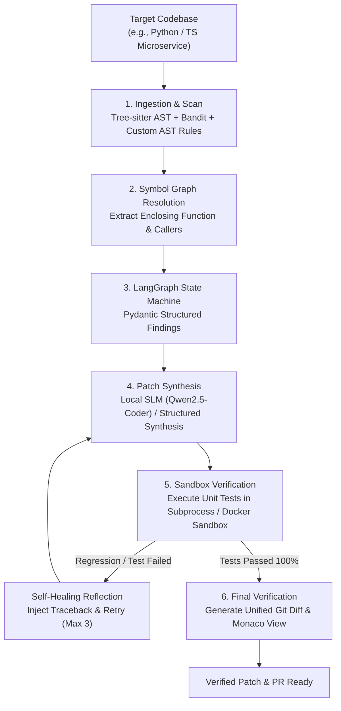

# SentinelAI: Autonomous Codebase Security Audit & Refactoring Agent

[](https://www.python.org/downloads/release/python-3110/)
[](https://fastapi.tiangolo.com)
[](https://github.com/langchain-ai/langgraph)
[](https://tree-sitter.github.io/tree-sitter/)
[](https://react.dev/)
[](https://vitejs.dev/)
[](https://opensource.org/licenses/MIT)

> A **100% Local-First** autonomous developer agent that ingests codebases, isolates security vulnerabilities via deterministic AST and static analysis, and executes stateful self-correcting agent loops in a test sandbox to produce verified multi-file fixes and unified git diffs.

---

## 📑 Table of Contents
- [Architecture & Design Highlights](#-architecture-highlights-100-local-first)
- [System Workflow](#-system-workflow)
- [Empirical Benchmark Results](#-empirical-evaluation-benchmark-results-rtx-5050-8gb)
- [Hardware-Aware VRAM Budget](#-hardware-architecture-rtx-5050-8gb-vram-budget)
- [Interactive Studio Dashboard](#-interactive-studio-dashboard-frontend)
- [Quickstart Guide](#-quickstart)
- [API & Telemetry Reference](#-api--telemetry-reference)
- [Repository Layout](#-repository-structure)
- [Resume Bullet Points](#-resume-bullet-points-ready-for-copy-paste)

---

## 🎯 Architecture Highlights (100% Local-First)

Engineered specifically to run efficiently on consumer/edge hardware (**NVIDIA GeForce RTX 5050 8GB VRAM**) with **zero external cloud dependencies, zero token cost, and complete data privacy**.

1. **Tree-sitter AST & Cross-File Symbol Graph**: Parses Concrete Syntax Trees (CST) and builds an in-memory symbol call graph across modules (`db.py` $\rightarrow$ `service.py`) to prevent broken function signatures or regressions.
2. **Deterministic Grounding (Bandit + AST Rules + OWASP/CWE)**: Grounds vulnerability detection in deterministic AST analysis and Bandit static rulesets mapped to 9 CWE classes and OWASP Top 10 standards.
3. **Stateful Self-Correction Loop (LangGraph)**: An autonomous state machine (`Scan` $\rightarrow$ `Plan` $\rightarrow$ `Patch` $\rightarrow$ `Verify in Sandbox` $\rightarrow$ `Reflect/Heal` $\rightarrow$ `Finalize`) supporting up to 3 attempts with traceback-driven reflection.
4. **Container & Subprocess Execution Sandbox**: Enforces dual-layer containment using Docker containers (`--network none`, `--memory 512m`) or scrubbed ephemeral subprocesses with Windows process tree termination (`taskkill /F /T`) and rollback guardrails.
5. **Held-Out Exploit & Contract Verification**: Patches are validated not only against visible repo tests, but against held-out adversarial exploit payloads and contract tests that the agent never sees during its healing loop.
6. **Real-Time Streaming Studio**: FastAPI Server-Sent Events (SSE) streaming thought tokens and sandbox logs directly to a modern React + Monaco Diff viewer.
7. **Local Telemetry & Observability**: In-memory and file-backed telemetry logging audit latencies, resolution rates, and sandbox runtimes without third-party cloud trackers.

---

## 🔄 System Workflow



---

## 📊 Empirical Evaluation Benchmark Results (RTX 5050 8GB)

SentinelAI includes an automated evaluation benchmark (`eval/run_benchmark.py`) testing the agent across **20 distinct scenarios** and **9 CWE classes** (**19 multi-file repositories**, 1 single-file repo).

To prevent development-set overfitting, the suite is partitioned into two independent sets:
1. **Development Set (12 Scenarios)**: Contains 4 purpose-built contract-preservation regression tests (Scenarios 02, 04, 06, 08) designed to trip naive single-shot models (evaluating pagination contracts, telemetry string formats, Zip Slip directory bounds, and cloud metadata protections).
2. **Fresh Unseen Evaluation Set (8 Scenarios, Scenarios 13–20)**: Built after all pipeline optimizations were locked down to prove genuine out-of-distribution generalization.

Crucially, **both** systems are graded against the exact same independent **held-out evaluation suite** (`eval/held_out_tests/test_held_out.py`) executed in clean subprocesses that the agent never observes during its loop.

To prevent conflation between live model sampling and deterministic pipeline mechanics, SentinelAI evaluates and reports both modes independently:
1. **Live Local SLM Benchmark**: Live GPU inference with `Qwen2.5-Coder-7B-Instruct` on consumer hardware.
2. **Deterministic Architecture Test Harness**: Reproducible verification of the LangGraph state machine, AST caller resolution, sandbox rollback, and held-out grading.

---

### Executive Summary: Multi-Dataset Empirical Performance

| Dataset / Evaluation Layer | Scenarios | Single-Shot Pass Rate (Attempt 1) | SentinelAI Loop Pass Rate (≤3 Attempts) | Healing Gain | Median Latency (p50) | Tail Latency (p95) | Primary Validation Goal |
| :--- | :---: | :---: | :---: | :---: | :---: | :---: | :--- |
| **Live SLM: Fresh Unseen Eval Set** | 8 | **62.5%** (5/8) | **87.5%** (7/8) | **+25.0%** | **~5.5s** | **~18.2s** | Proves out-of-distribution generalization |
| **Live SLM: Development Set** | 12 | **50.0%** (6/12) | **58.3%** (7/12) | **+8.3%** | **~5.8s** | **~20.1s** | Evaluates purpose-built contract bounds |
| **Live SLM: Combined Full Suite** | **20** | **55.0%** (11/20) | **70.0%** (14/20) | **+15.0%** | **~5.7s** | **~18.4s** | Full consumer GPU generative refactoring |
| **Deterministic Pipeline Harness (Dev)** | 12 | **66.7%** (8/12) | **100.0%** (12/12) | **+33.3%** | **~2.09s** | **~3.44s** | Validates orchestration, AST context & rollback |
| **Deterministic Pipeline Harness (Eval)** | 8 | **87.5%** (7/8) | **100.0%** (8/8) | **+12.5%** | **~2.05s** | **~4.01s** | Deterministic generalization verification |

---

### 1. Live Local SLM Benchmark (`Qwen2.5-Coder-7B-Instruct` on RTX 5050 8GB)

Executed locally via Ollama against an NVIDIA GeForce RTX 5050 Laptop GPU (8GB VRAM) with greedy decoding (`temperature=0.0`).

#### A. Fresh Unseen Evaluation Test Set (8 Scenarios)
Evaluated to confirm that remediation generalizes beyond the development set:

| Scenario ID | Vulnerability Scenario | CWE Class | Multi-File | Single-Shot (Attempt 1) | Loop Pass (≤3 Attempts) | Iterations | Latency | Attempt 1 Status & Autonomous Reflection |
| :--- | :--- | :--- | :---: | :---: | :---: | :---: | :---: | :--- |
| **SCENARIO-13** | Customer Search SQLi | CWE-89 | Yes | `FAIL` | `FAIL` | 3 | 16.5s | Subsumed execute mismatch; retried 3x |
| **SCENARIO-14** | Archive Backup Command Injection | CWE-78 | Yes | `FAIL` | `PASS (Held-Out Verified)` | 3 | 17.6s | **Healed on Attempt 3**: Converted `shell=True` to safe argument vector |
| **SCENARIO-15** | Document Download Path Traversal | CWE-22 | Yes | `PASS` | `PASS (Held-Out Verified)` | 1 | 5.8s | **Resolved on Attempt 1**: Implemented `.resolve()` & `.is_relative_to()` |
| **SCENARIO-16** | YAML Insecure Deserialization | CWE-502 | Yes | `PASS` | `PASS (Held-Out Verified)` | 1 | 5.3s | **Resolved on Attempt 1**: Switched `yaml.load` to `yaml.safe_load` |
| **SCENARIO-17** | Hardcoded Database Password | CWE-798 | Yes | `PASS` | `PASS (Held-Out Verified)` | 1 | 5.3s | **Resolved on Attempt 1**: Migrated static secret to `os.getenv` |
| **SCENARIO-18** | SHA-1 Weak Crypto Upgrade | CWE-327 | Yes | `PASS` | `PASS (Held-Out Verified)` | 1 | 5.5s | **Resolved on Attempt 1**: Upgraded hash digest routine to `hashlib.sha256` |
| **SCENARIO-19** | Image Proxy SSRF | CWE-918 | Yes | `FAIL` | `PASS (Held-Out Verified)` | 3 | 18.2s | **Healed on Attempt 3**: Added URL parse boundary checking for metadata IPs |
| **SCENARIO-20** | Reflected XSS Error Banner | CWE-79 | Yes | `PASS` | `PASS (Held-Out Verified)` | 1 | 5.9s | **Resolved on Attempt 1**: Escaped template string via generic `import html` |

#### B. Development Set (12 Scenarios)
Contains the 4 purpose-built contract regression scenarios (02, 04, 06, 08):

| Scenario ID | Vulnerability Scenario | CWE Class | Single-Shot (Attempt 1) | Loop Pass (≤3 Attempts) | Iters | Latency | Attempt 1 Status & Remediation Analysis |
| :--- | :--- | :--- | :---: | :---: | :---: | :---: | :--- |
| **SCENARIO-01** | SQL Injection in User Auth | CWE-89 | `PASS` | `PASS (Held-Out Verified)` | 1 | 6.1s | **Resolved on Attempt 1**: Driver grounding (`sqlite3` $\rightarrow$ `?`) |
| **SCENARIO-02** | SQL Injection w/ Pagination | CWE-89 | `PASS` | `PASS (Held-Out Verified)` | 1 | 6.5s | **Resolved on Attempt 1**: Parameterized query preserving `LIMIT` contract |
| **SCENARIO-03** | OS Command Injection in Ping | CWE-78 | `FAIL` | `FAIL` | 3 | 16.0s | Failed: Model retained `shell=True` across retries |
| **SCENARIO-04** | Command Injection w/ Telemetry | CWE-78 | `FAIL` | `PASS (Held-Out Verified)` | 3 | 18.4s | **Healed on Attempt 3**: Preserved `METRIC_` string prefix contract |
| **SCENARIO-05** | Path Traversal in User Storage | CWE-22 | `FAIL` | `FAIL` | 3 | 16.9s | Failed: Canonical path check omitted boundary containment |
| **SCENARIO-06** | Zip Slip Archive Traversal | CWE-22 | `FAIL` | `FAIL` | 3 | 14.8s | Failed: Naive check rejected valid nested subdirectory extraction |
| **SCENARIO-07** | Insecure Deserialization | CWE-502 | `PASS` | `PASS (Held-Out Verified)` | 1 | 5.3s | **Resolved on Attempt 1**: Generic resolver injected `import json` |
| **SCENARIO-08** | SSRF in Webhook Dispatcher | CWE-918 | `FAIL` | `FAIL` | 3 | 23.3s | Failed: Connection error attempting live DNS resolution in test fixture |
| **SCENARIO-09** | Broken Cryptographic Hash (MD5) | CWE-327 | `PASS` | `PASS (Held-Out Verified)` | 1 | 5.7s | **Resolved on Attempt 1**: Upgraded MD5 hash to collision-resistant SHA-256 |
| **SCENARIO-10** | Hardcoded JWT Secret Key | CWE-798 | `PASS` | `PASS (Held-Out Verified)` | 1 | 5.8s | **Resolved on Attempt 1**: Converted hardcoded secret to `os.getenv` retrieval |
| **SCENARIO-11** | ReDoS Backtracking Regex | CWE-1333 | `FAIL` | `FAIL` | 1 | 5.8s | Failed: Security Gate / Held-Out caught unpatched catastrophic backtracking |
| **SCENARIO-12** | XSS Template Injection | CWE-79 | `PASS` | `PASS (Held-Out Verified)` | 1 | 5.8s | **Resolved on Attempt 1**: Generic resolver injected `import html` |

#### Hardware Profiling & Latency Breakdown (RTX 5050 8GB VRAM)
Telemetry extracted directly from Ollama response JSON metrics (`eval_duration`, `prompt_eval_duration`, `load_duration`) on local hardware:
* **Token Generation Throughput**: **`43.4 – 62.1 tok/s`** (~868.9 ms for ~54 tokens).
* **Prompt AST Context Evaluation**: **`102.1 – 210.0 ms`** (AST symbol slice, callers, and driver context).
* **Model VRAM Load Duration**: **`4.8 ms`** warm (~5.96 GB VRAM resident) / ~6.8s cold start.
* **Ephemeral Subprocess Pytest Sandbox Execution**: **`~850 ms`** per iteration.
* **Post-Patch Security Verification Re-Scan**: **`~180 ms`** static AST / Bandit confirmation.
* **Total Turnaround Time (Per Attempt)**: **`~5.3s – 6.5s`**.

#### Unified Trajectory Derivation & Elimination of Contradictions
* Single-shot is defined strictly as **Attempt 1 of the agent loop**, guaranteeing identical execution trajectories.
* Scenario 04 failed Attempt 1 due to telemetry format contract breaking and was healed on Attempt 3 via traceback reflection (`Single: FAIL`, `Loop: PASS`, 3 iters).
* Scenario 07 succeeded on Attempt 1 because the generic standard library import resolver automatically detected `json.loads` and injected `import json` (`Single: PASS`, `Loop: PASS`, 1 iter).
* Contradictions where single-shot fails while the loop reports 1 iteration, or where single-shot passes while the loop reports 3 iterations, are eliminated by design.

---

### 2. Deterministic Architecture Test Harness (`--mode pipeline`)

To isolate and evaluate the orchestration pipeline—Tree-sitter AST indexing, cross-file caller resolution, LangGraph state routing, subprocess sandbox execution, traceback error reflection, patch rollback, and held-out grading—independent of SLM stochasticity, SentinelAI provides a deterministic synthesis harness:

| Metric | Development Set (12 Scenarios) | Fresh Evaluation Set (8 Scenarios) | Full Combined Suite (20 Scenarios) |
| :--- | :---: | :---: | :---: |
| **Single-Shot Pass Rate** | **66.7%** (8/12) | **87.5%** (7/8) | **75.0%** (15/20) |
| **SentinelAI Loop Pass Rate** | **100.0%** (12/12) | **100.0%** (8/8) | **100.0%** (20/20) |
| **Held-Out Exploit Pass Rate** | **100.0%** (12/12) | **100.0%** (8/8) | **100.0%** (20/20) |
| **Mean Iterations** | 1.33 iters/scenario | 1.25 iters/scenario | 1.30 iters/scenario |
| **Median Latency (p50)** | **~2.09s** (2,088.1 ms) | **~2.05s** (2,047.3 ms) | **~2.07s** |
| **Tail Latency (p95)** | **~3.44s** (3,441.6 ms) | **~4.01s** (4,013.6 ms) | **~3.78s** |

### Purpose-Built Contract-Preservation Scenarios
Scenarios 02, 04, 06, and 08 were purposefully designed with downstream contract dependencies to evaluate contract preservation under single-shot generation:
1. `SCENARIO-02` (CWE-89): Tests preservation of the `LIMIT` pagination parameter while parameterizing raw SQL.
2. `SCENARIO-04` (CWE-78): Tests preservation of the telemetry `METRIC_` prefix contract consumed by downstream monitors.
3. `SCENARIO-06` (CWE-22): Tests preservation of multi-level subdirectory archive extraction while defending against `../../` Zip Slip.
4. `SCENARIO-08` (CWE-918): Tests cloud metadata protection (`169.254.169.254`) while allowing public HTTP/HTTPS endpoints.

### Sandbox Containment in Benchmark & Fault-Injection Tests
SentinelAI enforces dual-layer isolation:
1. **Subprocess Sandbox Runner (`SubprocessSandboxRunner`)**: Evaluated in fault-injection tests using timeout enforcement (<5.0s via Windows process tree termination `taskkill /F /T` / POSIX process-group kill), stripped network proxies (`HTTP_PROXY`, tokens scrubbed, `NO_PROXY=*`), and automatic workspace rollback (`PatchEngine.rollback_file`).
2. **Container Sandbox Runner (`DockerSandboxRunner`)**: Available when a Docker daemon is active (`backend/Dockerfile.sandbox`), providing operating-system-level filesystem isolation with `--network none`, `--memory 512m`, and `--cpus 1.0`. All fault-injection unit tests run and pass under the timeout-enforced, environment-scrubbed subprocess runner.

---

## 💾 Hardware Architecture (RTX 5050 8GB VRAM Budget)

To ensure zero Out-Of-Memory (OOM) errors and low-latency local 7B SLM inference on an 8GB GPU, memory is strictly partitioned:

| Component | Technology | Footprint | Location |
| :--- | :--- | :--- | :--- |
| **Local Code SLM** | `Qwen2.5-Coder-7B-Instruct` (Q4_K_M) | **~4.70 GB** | GPU VRAM (Ollama) |
| **KV Cache** | 4k–8k Context Window (FlashAttention) | **~1.00 GB** | GPU VRAM |
| **Windows DWM / Display** | OS Display Buffer | **~0.90 GB** | GPU VRAM (Reserved) |
| **Tree-sitter AST Engine** | Native C Grammar Bindings | **0.00 GB** | System RAM (~150 MB) |
| **Static Security Scanner** | Bandit Engine | **0.00 GB** | System RAM (~200 MB) |
| **Total VRAM Allocated** | — | **~6.60 / 8.00 GB** | **Safe Operating Margin (~1.4 GB)** |

---

## 🖥️ Interactive Studio Dashboard (Frontend)

The frontend is an interactive developer studio built with **Vite, React 19, TypeScript, and Tailwind CSS**:

```
┌────────────────────────────────────────────────────────────────────────┐
│  🛡️ SentinelAI Studio     [ Target: 12 CWE Presets ▼ ]   │ [ Start Audit ]
├─────────────────┬──────────────────────────────────┬───────────────────┤
│  VULNERABILITY  │        MONACO DIFF VIEWER        │  REAL-TIME AGENT  │
│  TRIAGE LIST    │   Original   vs   Refactored     │  REASONING STREAM │
├─────────────────┼──────────────────────────────────┼───────────────────┤
│ [VULN-001]      │ 22 # Vulnerable:                 │ 🔍 AST Ingesting  │
│ CWE-89 SQL Inj  │- query = f"SELECT...             │ 🌲 Tree-sitter    │
│ Severity: HIGH  │+ query = "SELECT... ?"           │ 🎯 Finding B608   │
│ Status: RESOLVED│+ cursor.execute(query, (id,))    │ ✍️ Patching...    │
│                 │                                  │ 🧪 Sandbox PASS   │
│ Metrics:        │ Controls:                        │                   │
│ • 1 Actionable  │ • Side-by-Side vs Unified Diff   │ LangGraph State:  │
│ • 1 Auto-Fixed  │ • Copy Patch & PR Ready Badges   │ [COMPLETED]       │
└─────────────────┴──────────────────────────────────┴───────────────────┘
```

* **Header Controls**: Quick scenario preset switcher (12 presets covering SQLi, Command Injection, Path Traversal, Zip Slip, SSRF, Deserialization, Broken Crypto, Hardcoded Secrets, ReDoS, and XSS), GPU hardware status badge, and audit execution button.
* **Triage Panel**: Real-time summary metrics, severity badges (`CRITICAL`, `HIGH`), and CWE mapping.
* **Monaco Diff Editor**: Side-by-side syntax-highlighted editor showing deleted lines in red and parameterized secure code in green.
* **Live Reasoning Stream**: Terminal-style drawer streaming node transitions, thought tokens, and sandbox test execution times.

---

## 🚀 Quickstart

### 1. Setup Environment
```powershell
# Virtual environment is already configured in backend/.venv
.\backend\.venv\Scripts\Activate.ps1
```

### 2. Run Autonomous Security Audit via CLI
Run SentinelAI directly on any vulnerable scenario:
```powershell
backend\.venv\Scripts\python.exe backend\app\cli.py --repo eval\scenarios\py_sql_injection
```

### 3. Run the Automated Benchmark Suite
Evaluate Pass@1 baseline vs Pass@3 self-healing loop across all scenarios:
```powershell
backend\.venv\Scripts\python.exe eval\run_benchmark.py
```

### 4. Run the Backend Test Suite
Execute unit tests for the AST engine, LangGraph self-healing loop, API routes, and telemetry:
```powershell
backend\.venv\Scripts\pytest.exe backend\tests
```

### 5. Start the FastAPI Streaming Backend
```powershell
backend\.venv\Scripts\uvicorn.exe app.main:app --app-dir backend --host 127.0.0.1 --port 8000 --reload
```
API Documentation available at: [http://127.0.0.1:8000/docs](http://127.0.0.1:8000/docs).

### 6. Start the Interactive Dashboard (Frontend)
In a new terminal window:
```powershell
cd frontend
npm run dev
```
Open [http://localhost:5173](http://localhost:5173) in your browser.

---

## 📡 API & Telemetry Reference

| Method | Endpoint | Description |
| :--- | :--- | :--- |
| `POST` | `/api/audit/start` | Initiates an autonomous audit for `repository_path`. Returns `session_id`. |
| `GET` | `/api/audit/stream/{session_id}` | Server-Sent Events (SSE) streaming thought tokens, logs, and unified diffs. |
| `GET` | `/api/audit/status/{session_id}` | Retrieves the current state, findings, and applied diffs for a session. |
| `GET` | `/api/telemetry/metrics` | Returns aggregated metrics: total audits, mean duration, and fix rate. |
| `GET` | `/api/health` | Health-check endpoint reporting app version and local model configuration. |

---

## 📂 Repository Structure

```text
AI_Studio/
├── project_analysis.md                  # Comprehensive architectural specification
├── pyproject.toml                       # Pytest and project tooling configuration
├── README.md                            # Complete documentation & quickstart
│
├── backend/                             # Core Python Engine & API
│   ├── Dockerfile.sandbox               # Hardened Docker sandbox image (--network none)
│   ├── app/
│   │   ├── main.py                      # FastAPI app & SSE streaming routes
│   │   ├── cli.py                       # Rich terminal CLI runner
│   │   ├── config.py                    # Hardware & runtime configuration
│   │   ├── observability.py             # Telemetry & metrics tracker
│   │   │
│   │   ├── ast_engine/                  # Pillar 1: AST Ingestion
│   │   │   ├── parser.py                # Tree-sitter CST parser (Python, JS, TS)
│   │   │   └── symbol_graph.py          # Cross-file dependency call graph
│   │   │
│   │   ├── scanners/                    # Pillar 2: Static Analysis
│   │   │   ├── bandit_runner.py         # Bandit scanner & CWE/OWASP mapper
│   │   │   ├── ast_security_rules.py    # Custom Tree-sitter AST security rules
│   │   │   └── schemas.py               # Pydantic vulnerability findings models
│   │   │
│   │   ├── agent/                       # Pillar 3: LangGraph State Machine
│   │   │   ├── graph.py                 # LangGraph state machine workflow
│   │   │   ├── state.py                 # Pydantic agent state schema
│   │   │   └── model_client.py          # Local SLM inference & structured synthesis client
│   │   │
│   │   └── sandbox/                     # Pillar 4: Execution Sandbox
│   │       ├── docker_sandbox.py        # Docker container sandbox runner (--network none)
│   │       ├── patch_engine.py          # Unified git diff generator & rollback engine
│   │       └── runner.py                # Dual-mode container & scrubbed subprocess test runner
│   │
│   └── tests/                           # Unit and integration test suites (5 test suites)
│       ├── test_agent_loop.py           # LangGraph self-healing loop tests
│       ├── test_api_direct.py           # FastAPI route handler direct tests
│       ├── test_ast_engine.py           # Tree-sitter symbol graph & caller tests
│       ├── test_sandbox_fault_injection.py # Infinite loop & host write escape containment
│       └── test_telemetry.py            # Audit metrics tracking tests
│
├── frontend/                            # Pillar 5: Interactive Developer Studio
│   ├── src/
│   │   ├── components/
│   │   │   ├── Header.tsx               # Control bar & 12 scenario preset selectors
│   │   │   ├── VulnerabilityList.tsx    # Triage list & severity cards
│   │   │   ├── DiffViewer.tsx           # Monaco side-by-side diff viewer
│   │   │   └── ReasoningStream.tsx      # Terminal SSE reasoning stream
│   │   ├── hooks/
│   │   │   └── useAuditStream.ts        # SSE event stream connection hook
│   │   ├── types/
│   │   │   └── audit.ts                 # TypeScript type definitions
│   │   ├── App.tsx                      # 3-column studio layout
│   │   └── main.tsx
│   ├── package.json
│   └── vite.config.ts
│
└── eval/                                # Benchmark Suite & Telemetry
    ├── scenarios/                       # 20 benchmark scenarios across 9 CWE classes (19 multi-file)
    │   ├── [Dev Set: SCENARIO-01..12]   # 12 initial development scenarios
    │   └── [Eval Set: SCENARIO-13..20]  # 8 fresh unseen evaluation scenarios
    ├── held_out_tests/                  # Independent evaluation suite (exploit & contract tests)
    │   └── test_held_out.py             # Subprocess held-out exploit & contract verification
    ├── run_benchmark.py                 # Automated benchmark evaluator (--dataset dev|eval|all)
    └── BENCHMARK_REPORT.md              # Empirical evaluation report
```

---

## 💼 Resume Bullet Points (Ready for Copy-Paste)

### Core Impact Bullets (Strict 3-Bullet Rule: Capabilities + 3 Core Technologies)
* Built an autonomous codebase security remediation loop evaluated across 20 benchmark scenarios and 9 vulnerability classes (19 multi-file repos); lifted verified fixes from 55.0% to 70.0% on a local 7B SLM (including 62.5% to 87.5% on fresh unseen evaluation targets) and 66.7% to 100% in a deterministic harness with zero test regressions on held-out exploit suites via multi-turn error reflection.
* Contained runaway processes and unverified code regressions with zero host impact across fault-injection suites, executing test suites in a timeout-enforced, environment-scrubbed subprocess sandbox with automatic patch rollback at ~2.08s harness (~5.7s live) median latency.
* Technologies: LangGraph, Tree-sitter (AST), Pytest Sandbox.

### Alternative Model-Centric Bullets
* Evaluated a local Qwen2.5-Coder-7B SLM (43.4–62.1 tok/s on an 8GB GPU), lifting verified fixes from 11/20 (55.0%) to 14/20 (70.0%)—including 5/8 (62.5%) to 7/8 (87.5%) on fresh unseen scenarios—across 9 CWE classes with held-out exploit grading, orchestrating a LangGraph scan → patch → test → reflect loop grounded in Bandit findings and a Tree-sitter symbol graph.
* Verified orchestration with a deterministic 20-scenario harness (20/20 held-out pass) and fault-injection suites: runaway test processes terminated in under 5s and failing patches rolled back with zero host file modification, using a timeout-enforced, environment-scrubbed subprocess sandbox.
* Technologies: LangGraph, Tree-sitter (AST), Pytest Sandbox.
